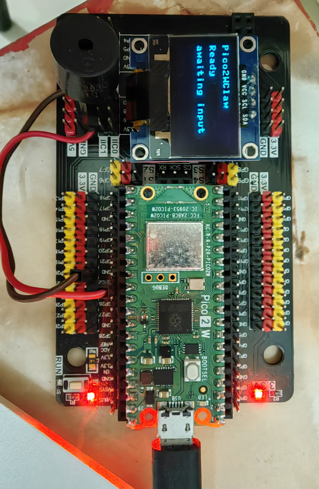

# :mouse: Welcome to Pico2WClaw

<p align="center">
 
</p>

<p align="center">
<i>The intelligence of an AI is only as good as the model used.</i><br><br>
&nbsp; &nbsp; &nbsp; &nbsp; &nbsp; &nbsp; &nbsp; &nbsp; &nbsp;
&nbsp; &nbsp; &nbsp; &nbsp; &nbsp; &nbsp; &nbsp; &nbsp; &nbsp;
&nbsp; &nbsp; &nbsp; &nbsp; &nbsp; &nbsp; &nbsp; &nbsp; &nbsp;
&nbsp; &nbsp; &nbsp; &nbsp; &nbsp; &nbsp; &nbsp; &nbsp; &nbsp; ― Bernard Chan
</p> 

## Table of Contents
- [Description](#scroll-description)
- [Development Platform](#computer-development-platform)
- [Software Development](#floppy_disk-software-development)
- [Platform Tested](#iphone-platform-tested)
- [Screenshots](#film_strip-screenshots)
- [Buy Me a Coffee](#coffee-buy-me-a-coffee)
- [License](#page_with_curl-license)
- [Feedback and Suggestions](#speech_balloon-feedback-and-suggestions)

## :scroll: Description
Development of a small Autonomous AI Agent in Raspberry Pi Pico 2 W. \
The Micropython program runs on Raspberry Pi Pico 2 W.

## :computer: Development Platform
I have tested on Raspberry Pi Pico 2 W running Thonny. It may also work on Raspberry Pi Pico W.

On the Raspberry Pi Pico 2 W:
1. Do ensure that the Raspberry Pi Pico 2 W is flashed with the correct *.uf2 file
2. The RPI_PICO2_W-20260824-v1.29.0.uf2 file can be downloaded from resources folder in this repository.
3. Open Thonny and upload all the files in the repository folder /pico2wclaw onto Raspberry Pi Pico W. Program is written in MicroPython.
4. Open the file boot2.py
5. Run boot2.py. The following output will be displayed in the Thonny run window.

Note: You can rename boot2.py to boot.py so that the program will automatically run when Raspberry Pi Pico 2 W power up.
~~~~
MPY: soft reboot

==================================================
  Pico2WClaw booting...
==================================================
[wifi] connecting to chanhome 2.4GHz ...
[wifi] waiting... (1/20)
[wifi] waiting... (2/20)
[wifi] waiting... (3/20)
[wifi] waiting... (4/20)
[wifi] waiting... (5/20)
[wifi] waiting... (6/20)
[wifi] waiting... (7/20)
[wifi] waiting... (8/20)
[wifi] waiting... (9/20)
[wifi] waiting... (10/20)
[wifi] connected: ('192.168.0.24', '255.255.255.0', '192.168.0.1', '192.168.0.1')
[boot] time synced via NTP
[boot] Telegram polling started
==================================================
  Pico2WClaw ready.
  Type a message and press Enter.
  Commands: /info, /memory, /clear, /tools
==================================================
> /tools
/tools
  led_blink_start: Start blinking the onboard LED at a given frequency (Hz). IMPORTANT: Use this tool for persistent blinking. Do NOT use exec_code to create timers or threads — they die when exec_code returns. Use Pin('LED') for the onboard LED, not Pin(25).
  beep_now: Play a beep on the buzzer. freq in Hz, duration in seconds.
  pwm_set: Set PWM frequency and duty on a GPIO pin.
  gpio_read: Read digital state of a GPIO pin.
  device_info: Return Pico 2 W hardware info (CPU, RAM, temp, WiFi RSSI).
  exec_code: Execute MicroPython code on the device. Returns stdout or error.
  gpio_write: Set a GPIO pin HIGH or LOW. Use for LEDs, relays, transistors.
  i2c_scan: Scan I2C bus for connected devices.
  led_blink_stop: Stop the persistent onboard-LED blink and turn the LED off.
  display_text: Write up to 4 lines on the OLED display (128x64).
  start_blink: Start blinking the onboard LED with an explicit period in milliseconds. Use this when the user specifies a duration like 'every 2 seconds'. IMPORTANT: Use this tool for persistent blinking. Do NOT use exec_code to create timers or threads — they die when exec_code returns. Use Pin('LED') for the onboard LED, not Pin(25).
  adc_read: Read 12-bit ADC value and voltage from a pin.
  led_toggle: Toggle the onboard LED once.
> [telegram] message from 8684515324 : /tools
[telegram] message from 8684515324 : /info
/info
/info
Board: Raspberry Pi Pico 2 W (RP2350)
CPU freq: 150 MHz
RAM: ~512 KB
Flash: 4 MB
Chip temp: 35.9C
WiFi RSSI: -59 dBm
MicroPython: 3.4.0;
> 
~~~~
6. Raspberry Pi Pico 2 W is now ready and accepting command from Hermes Agent running on the MacBook Air 2017. 

## :floppy_disk: Software Development:
I have two systems, one in MacBook Air 2017 and the other in Raspberry Pi Pico W. 

On Raspberry Pi Pico 2 W, there would be Micropython code that:
- pin assigned below:
- GP20 -> SDA (SSD1306 OLED)
- GP21 -> SCL (SSD1306 OLED)
- communicate with MacBook Air 2017 through Bluetooth.
- Accepts command from Hermes Agent to turn ON or OFF onboard LED
- OLED SSD1306 8 lines displays: 
  first line (button pressed status), second line joystick x and third line joystick y axis

    
## :iphone: Platform tested:
I have tested my code on:
- MacBook Air 2017 with Sequioa MacOS running Thonny with Raspberry Pi Pico 2 W

## :film_strip: Screenshots
<p float="left">
  
</p>

## :coffee: Buy Me a Coffee
If you appreciate my work, do support me by...<br>
<a href="https://www.buymeacoffee.com/chanlhock" target="_blank"></a>

## :page_with_curl: License
```
This program is licensed under the GNU General Public License v3.0 
Permissions of this strong copyleft license are conditioned on making  
available complete source code of licensed works and modifications,  
which include larger works using a licensed work, under the same  
license. Copyright and license notices must be preserved. Contributors  
provide an express grant of patent rights.
```
See the [GNU General Public License](LICENSE) for more details.

## :speech_balloon: Feedback and Suggestions
For any feedback or suggestions, feel free to contact me via email:\
:email: chanlhock@gmail.com :mouse:

