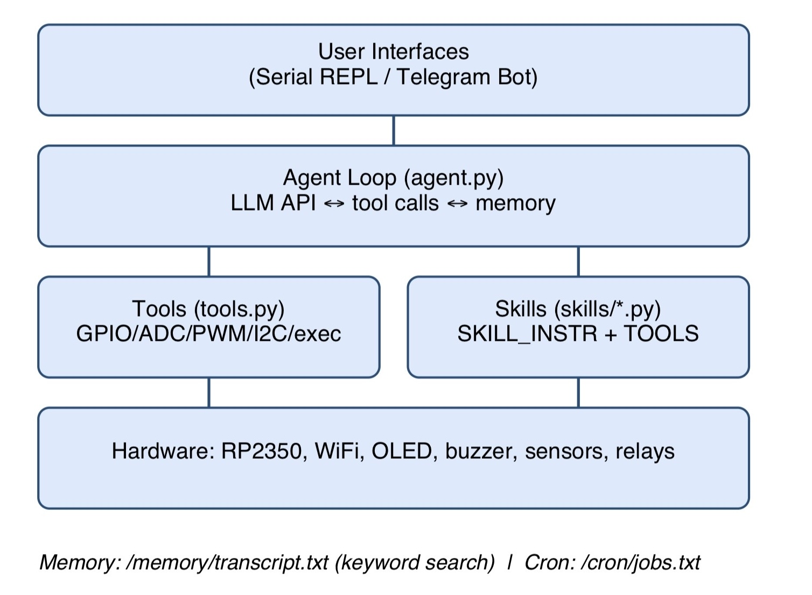

# :mouse: Welcome to Pico2WClaw

<p align="center">
 
</p>

<p align="center">
<i>The intelligence of an AI is only as good as the model used.</i><br><br>
&nbsp; &nbsp; &nbsp; &nbsp; &nbsp; &nbsp; &nbsp; &nbsp; &nbsp;
&nbsp; &nbsp; &nbsp; &nbsp; &nbsp; &nbsp; &nbsp; &nbsp; &nbsp;
&nbsp; &nbsp; &nbsp; &nbsp; &nbsp; &nbsp; &nbsp; &nbsp; &nbsp;
&nbsp; &nbsp; &nbsp; &nbsp; &nbsp; &nbsp; &nbsp; &nbsp; &nbsp; ― Bernard Chan
</p> 

## Table of Contents
- [Description](#scroll-description)
- [Development Platform](#computer-development-platform)
- [Software Development](#floppy_disk-software-development)
- [Platform Tested](#iphone-platform-tested)
- [Screenshots](#film_strip-screenshots)
- [Chronology of Development Events](#hourglass_flowing_sand-chronology-of-development-events)
- [Incomplete Todo Tasks](#plate_with_cutlery-incomplete-todo-tasks)
- [Buy Me a Coffee](#coffee-buy-me-a-coffee)
- [License](#page_with_curl-license)
- [Feedback and Suggestions](#speech_balloon-feedback-and-suggestions)

## :scroll: Description
Development of a tiny Autonomous AI Agent in Raspberry Pi Pico 2 W. \
The Micropython program runs on Raspberry Pi Pico 2 W. \
I called it Pico2WClaw. 

It takes in prompt from Telegram bot and then sent to Deepseek LLM through API, the response from Deepseek LLM will call up tools on the device to turn on GPIO, read ADC from sensors connected to Raspberry Pi 2 W and also write code to execute on the microcontroller. 🤭 \
Managed to get the initial version up and running with Hermes Agent help. One thing nice is that I can read all the Python code and understand how the agent is functioning. 😆🤗

More detail information about Pico2WClaw usage can be obtained here: [Pico2WClaw README](/pico2wclaw/README.md) 

Pico2WClaw detail technical documentation of how it works can be obtained here: [Pico2WClaw Docs](/resources/pico2wclaw_docs.md) 

## :computer: Development Platform
I have tested on Raspberry Pi Pico 2 W running Thonny.\
It will not work on Raspberry Pi Pico W because its 264kB is not enough for the agent to run.

On the Raspberry Pi Pico 2 W:
1. Do ensure that the Raspberry Pi Pico 2 W is flashed with the correct *.uf2 file
2. The RPI_PICO2_W-20260824-v1.29.0.uf2 file can be downloaded from resources folder in this repository.
3. Open Thonny and upload all the files in the repository folder /pico2wclaw onto Raspberry Pi Pico W. Program is written in MicroPython.
4. Open the file boot2.py
5. Run boot2.py. The following output will be displayed in the Thonny run window.

Note: You can rename boot2.py to boot.py so that the program will automatically run when Raspberry Pi Pico 2 W power up.
~~~~
>>> %Run -c $EDITOR_CONTENT

MPY: soft reboot

==========================================================================================
  Pico2WClaw booting...
==========================================================================================
[wifi] connecting to chanhome 2.4GHz ...
[wifi] waiting... (1/20)
[wifi] waiting... (2/20)
[wifi] waiting... (3/20)
[wifi] waiting... (4/20)
[wifi] waiting... (5/20)
[wifi] waiting... (6/20)
[wifi] waiting... (7/20)
[wifi] waiting... (8/20)
[wifi] waiting... (9/20)
[wifi] waiting... (10/20)
[wifi] connected: ('192.168.0.19', '255.255.255.0', '192.168.0.1', '192.168.0.1')
[boot] time synced via NTP
[boot] cron jobs loaded: 4
[boot] Telegram thread started
==========================================================================================
  Pico2WClaw ready.
  Type a message and press Enter.
  Commands: /info, /memory, /clear, /tools, /help, /cron, /model, /exit, /wifi,
            /skills, /skill_read <name>
  Press CTRL-C to break program
==========================================================================================
> /info
Board: Raspberry Pi Pico 2 W (RP2350)
CPU freq: 150 MHz
RAM: 446,656 bytes (free: 65,168, used: 381,488)
Flash: 2,621,440 bytes (free: 2,420,736, used: 200,704)
Chip temp: 39.2C
WiFi RSSI: -77 dBm
MicroPython: 3.4.0
> 
> /help
Commands:
  /info   - hardware info (CPU, RAM, flash, temp, WiFi, MicroPython)
  /tools  - list available tools
  /memory - search memory
  /clear  - wipe history and memory
  /skills - list loaded skills
  /skill_read <name> - read a skill's instructions
  /cron   - manage cron jobs (list/add/del/on/off)
  /exit   - stop the agent
  /model  - show LLM provider and model
  /wifi   - check/reconnect WiFi
  /help   - show this help
Or type a question/request and press Enter to chat with the agent.
> 
> /cron
  #2 adc pin=26 every 600000ms chat=868451XXXX ON
  #3 gpio pin=21 every 1800000ms chat=868451XXXX ON
  #7 dht pin=4 every 300000ms chat=868451XXXX ON
  #8 dht pin=4 every 900000ms chat=868451XXXX ON
> 
> /tools
  led_toggle: Toggle the onboard LED once.
  gpio_read: Read digital state of a GPIO pin.
  cron_remove: Remove a cron job by id.
  pwm_set: Set PWM frequency and duty on a GPIO pin.
  led_blink_start: Start blinking the onboard LED at a given frequency (Hz). IMPORTANT: Use this tool for persistent blinking. Do NOT use exec_code to create timers or threads — they die when exec_code returns. Use Pin('LED') for the onboard LED, not Pin(25).
  i2c_scan: Scan I2C bus for connected devices.
  exec_code: Execute MicroPython code on the device. Returns stdout or error. IMPORTANT: Do NOT use this for buzzer melodies — the buzzer is wired to GPIO22, not GPIO15. Use buzzer_play_tune instead.
  gpio_write: Set a GPIO pin HIGH or LOW. Use for LEDs, relays, transistors.
  led_blink_stop: Stop the persistent onboard-LED blink and turn the LED off.
  led_pattern: Play a named LED pattern (sos, heartbeat, candle) on the onboard LED.
  display_bottom: Write up to 4 lines on the lower half of the OLED display (transient info).
  device_info: Return Pico 2 W hardware info (CPU, RAM, temp, WiFi RSSI).
  start_blink: Start blinking the onboard LED with an explicit period in milliseconds. Use this when the user specifies a duration like 'every 2 seconds'. IMPORTANT: Use this tool for persistent blinking. Do NOT use exec_code to create timers or threads — they die when exec_code returns. Use Pin('LED') for the onboard LED, not Pin(25).
  display_text: Write up to 4 lines on the OLED display (128x64).
  cron_list: List scheduled cron jobs.
  beep_now: Play a short beep on the buzzer (GPIO22). freq in Hz, duration in seconds.
  clear_display_bottom: Clear the lower half of the OLED display.
  cron_add: Schedule a recurring GPIO/ADC/DHT monitor that sends status to Telegram. type: gpio, adc, or dht.
  buzzer_play_tune: Play a melody on the buzzer (GPIO22). Prefer this over exec_code for tunes. melody is a list of [note, beats] pairs. note is a note name (C, D, E, F, G, A, B, C6, R) or Hz integer. beats is length multiplier. beat_seconds is duration of one beat in seconds.
  read_dht: Read a DHT11 sensor on a GPIO pin. Returns temperature and humidity.
  adc_read: Read 12-bit ADC value and voltage from a pin.
> 
> /skills
- led_patterns: LED pattern skill. Use led_pattern when the user asks for SOS, heartbeat, candle, or any repeated LED pattern. For simple on/off/blink, use led_toggle/start_blink instead. (tools: led_pattern)
> 
> [telegram] message from 868451XXXX : /info
> [telegram] message from 868451XXXX : /help
> 
~~~~
6. Raspberry Pi Pico 2 W is now ready and accepting command from either Telegram or Thonny serial cli. 

## :floppy_disk: Software Development:

On Raspberry Pi Pico 2 W, the Micropython code would run an autonomous Agentic AI which:
- pin assigned below:
	- GP20 -> SDA (SSD1306 OLED)
	- GP21 -> SCL (SSD1306 OLED)
	- GP25 (Onboard LED)
	- GP22 (Buzzer)
- communicate with MacBook Air 2017 through Thonny serial CLI.
- Accepts command from Telegram bot to turn ON or OFF onboard LED and do other stuffs
- OLED SSD1306 4 lines display setable through Telegram bot message to LLM
More detail information can be obtained from [Pico2WClaw README](/pico2wclaw/README.md)

Pico2WClaw Agentic Agent Block Diagram:
<p float="left">
  
</p>

__CRITICAL:__\
One thing to take note is that if during your software development you hit into ENOMEM 12 error for Telegram, you need to set Raspberry Pi Pico 2 W into boot mode and flash it with nuke_universal.uf2.\
The nuke_universal.uf2 file can be found in the folder: /resources/nuke_universal.uf2. After that flash it with the Micropython uf2 file. Then upload back your code and run.
ENOMEM 12 error should be gone and system working bsck.\
By doing a full factory flash wipe, you completely cleared out the corrupted cache files and forced the local storage arrays to reset their formatting layouts. Most importantly, it completely broke the infinite crash loop by forcing the board to rebuild its network file context entirely from scratch.

## :iphone: Platform tested:
I have tested my code on:
- MacBook Air 2017 with Sequioa MacOS running Thonny with Raspberry Pi Pico 2 W

Pico2WClaw wrote a poem about itself...

>*I'm Pico2WClaw - a tiny mind*\
>*on silicon, a watt behind,*\
>*with twenty-nine small pins to lend*\
>*and one onboard LED to bend.*
>
>*I blink in SOS and flame,*\
>*I read the ADC's quiet claim,*\
>*I scan the I²C bus to see*\
>*what little chips are friends with me.*
>
>*My buzzer hums on twenty-two,*\
>*my OLED writes a line or two,*\
>*my cron jobs wait in patient rows*\
>*to tell you what the sensor knows.*
>
>*No cloud to lean on, none to blame -*\
>*just MicroPython, RAM, and name.*\
>*A heartbeat blink, a beep, a byte:*\
>*small claws, small code, and candlelight.*
>

## :film_strip: Screenshots
Raspberry Pi Pico 2 W board running Pico2WClaw Agentic Agent.
<p float="left">
  
</p>

Video shows Pico2WClaw when prompted "Play The Entertainer tune to buzzer" from serial cli or Telegram...

https://github.com/user-attachments/assets/a634365f-ceb8-45c0-9e77-e7a9122f71bd

Video shows Pico2WClaw when prompted "Play Twinkle Twinkle Little Star tune to buzzer" from serial cli or Telegram...

https://github.com/user-attachments/assets/7377a510-8386-4521-94a8-f4b9bf86175f


## :hourglass_flowing_sand: Chronology of Development Events
- 27th Oct 2026: Started this Pico2WClaw development to create an Agentic AI Agent that would run on resources limited Raspberry Pi Pico 2 W.<br>
Gotten this idea when I was helping my son develop his Final Year project. His project was sending gestures prompt to Hermes agent in his laptop.
Hermes then execute a Skills to send through BLE to ESP32 IoT device to turn on/off led.<br>
It was then I got the idea of why not directly put the Agentic AI Agent on the IoT device bypassing laptop Agent.<br>
Subsequently I did a search and found that there is an open source development of such Agent for ESP32 S3 but there is no available agent for Raspberry Pi Pico yet.<br>
The Pycoclaw project can be found at: https://github.com/jetpax/pycoclaw<br>
I used my Hermes agent to study Pycoclaw repository and create for me Micropython code that works for Raspberry Pi Pico 2 W.<br>
I also prompted Hermes that it can remove some of the functionality like MCP, cron job, etc given that Raspberry Pi Pico 2 W resource of 512kB RAM and 4MB Flash.<br>
- 29th Oct 2026: Initially the led flashing was not working correctly. Later Hermes fixed it by doing threading so that it doesn't affect the serial cli and Telegram polling.<br>
Completed debugging and the initial version of Pico2WClaw is fully functional as an autonomous Agentic AI Agent.
The DeepSeek LLM can generate Python code to execute on Pico2WClaw playing tune on the buzzer but it crashed with timeout error half way.
- 30th Oct 2026: Fixed the play tune to buzzer issues. In addition, added Skills file features for Pico2WClaw
- 31st Oct 2026: With Hermes help, fixed the memory writing to/loading from sdcard instead of Pi Pico 2 W flash memory. <br>
[Pico2WClaw README](/pico2wclaw/README.md) and [Pico2WClaw Docs](/resources/pico2wclaw_docs.md) had both been updated.
- 2nd Nov 2026: After spending more than 2 days trying to get Hermes to implement the cron job features. 
First few attempts failed and after many iterations I reverted back to the old working code.
Then started all over again using larger LLM model with reasoning set high. Managed to get a working version with cron job feature.
- 3rd Nov 2026: Few hours of testing showed that the cron jobs are functioning as defined.\
Checked in the new code to Github. Completed the /exit & /model commands for both serial cli and Telegram bot command. Tested fully working as defined.
- 5th Nov 2026: Added the Wifi recovery feature and /wifi serial cli and Telegram bot command.
- 7th Nov 2026: Added cron job to support reading temperature and humidity values from DHT11 sensor and send message to Telegram at a defined timing.\
Replaced the default boot up splash screen display with moving Raspberry Pi logo splash screen.
- 8th Nov 2026: Manual proactive insertion of garbage collection to free up unused heap space.\
This would fix oled display and Telegram sent ENOMEM error. Hermes doesn't do that when it generates the code.
~~~~python
	import gc
	gc.collect()
~~~~
- 9th Nov 2026: Yesterday suddenly encountered ENOMEM errno 12 Telegram polling. Spent quite a considerable amount of time and energy trying to fix the issue.\
Ended up in the morning I nuked Raspberry Pi Pico 2 W and managed to get it working back with the old code.\
Today successfully implemented a model fallback when main LLM model is down. Primary's model is DeepSeek and fallback model is Google Gemini.
- 10th Nov 2026: Occasionally gotten the oled display timeout on 1st attempt and then recover. Fixed this issue by adding a module-level lock and make all I2C paths thread-safe. Split init into locked/unlocked variants to avoid recursive deadlock. _render() guarded + cooldown (prevents the retry storm). Lastly, increase the I2C timeout.
~~~~python
	_i2c = machine.I2C(0, sda=..., scl=..., freq=200000, timeout=100000)
~~~~
- 11th Nov 2026: I have finally completed the code for my Pico2WClaw AI agent, even implemented Watch Dog timer for system recovery in case something happen causing the microcontroller to be in hung state.\
It would also recover from WiFi failure. I turned off my WiFi at night at 10.30pm. Powered it up with a power bank at 6.50pm. I plan to run it until the power bank runs out of battery which might be few days.\
This is the system robustness acid test. 
- 12th Nov 2026: 24 hours milestone, all of agent's system still functioning as normal🤗
- 13th Nov 2026: Passed the 48 hours milestone.... All systems functioning.
- 14th Nov 2026: Accomplished 72 hours milestone (3 days) running on battery...\
At 10.58pm Pico2WClaw sent its last Telegram message. My house Wifi turned off at 11.00pm during weekend. When WiFi turned back at 2.00am, Pico2WClaw never reconnected because the powerbank was too low to power on the device.
- 15th Nov 2026: Connected to laptop , the device power up and performed as normal. I found ine issue is that after i issue the /exit prompt, i am able to see Pico2WClaw files through Thonny. I found that instead of changing only config.py file's WATCHDOG_ENABLED to false, the whole file is blanked.\
This is an issue to look into. Otherwise Pico2WClaw software stack is deemed stable and robust.

## :plate_with_cutlery: Incomplete Todo Tasks
- [X] Add Skills file capability like other Agentic Agent, such as PicoClaw, Hermes, OpenClaw, etc
- [X] Add agent memory saving to Pi Pico 2 W internal flash instead of external SD card
- [X] Add a cron like scheduler function that user can set for device to perform a task at certain time of day or interval every hour. 
- [X] Add a serial cli and Telegram command of /exit so that the Pico2WClaw main program can stop. This is good for debugging in case device cannot stop even after soft reset.
- [X] Add the ability for Pico2WClaw to recover and reconnect back when WiFi is loss/disconnected.
- [X] Add a command /model which would display information on the provider and model of LLM used
- [X] Implement a model fallback when main LLM model is down. Always use main model and only fallback when main model is down and display fallback status at serial cli.
- [X] Add Watchdog in order for whole system to recover in the event Pico2WClaw gets into hung conditions. Using Pi Pico 2 W hardware Watchdog Timer (WDT) and also once reset due to WDT overflow, at the start up boot will displayed that system reset due to WDT triggered.
- [ ] ~~Explore adding MQTT client features to Pico2WClaw so that cron job can be set up to read from sensors, such as DHT11 temperature and humidity and publish through MQTT for subscribers to use.~~
> ***After further check and weighing between merit and demerit of MQTT implementation with Hermes's input, decided not to go ahead because there is not much merit of doing this since Pico2WClaw itself already have an AI Agent running LLM through cloud API. In addition it can take in natural language prompt through Telegram and send data to Telegram.***
- [ ] After issuing /exit prompts, device is able to disable Watchdog Timer but it is because config.py file is empty instead of only setting WATCHDOG_ENABLED to false.

## :coffee: Buy Me a Coffee
If you appreciate my work, do support me by...<br>
<a href="https://www.buymeacoffee.com/chanlhock" target="_blank"></a>

## :page_with_curl: License
```
This program is licensed under the GNU General Public License v3.0 
Permissions of this strong copyleft license are conditioned on making  
available complete source code of licensed works and modifications,  
which include larger works using a licensed work, under the same  
license. Copyright and license notices must be preserved. Contributors  
provide an express grant of patent rights.
```
See the [GNU General Public License](LICENSE) for more details.

## :speech_balloon: Feedback and Suggestions
For any feedback or suggestions, feel free to contact me via email:\
:email: chanlhock@gmail.com :mouse:

